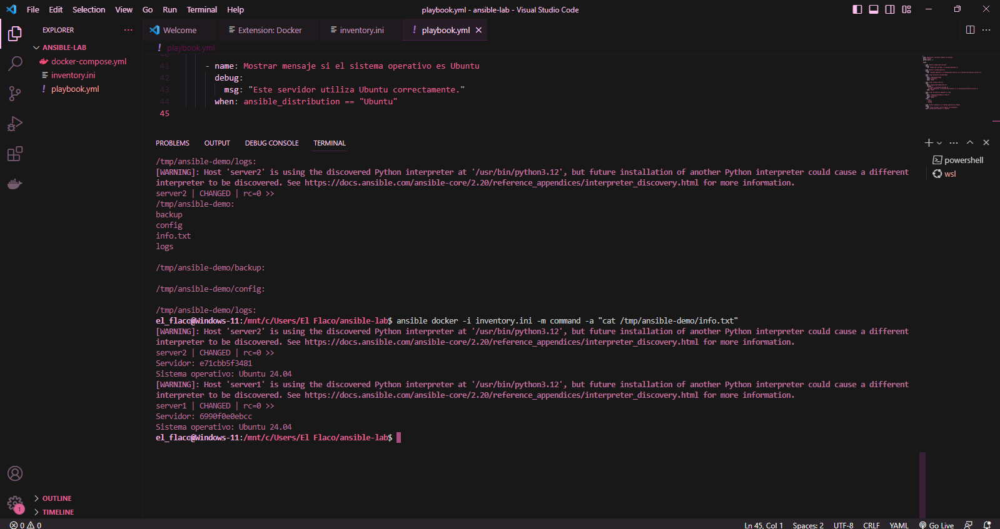

# Laboratorio de Ansible con Docker

**Estudiante:** Vanessa Collado  
**Asignatura:** Introducción a DevOps

## 1. Objetivo

Crear un laboratorio con dos servidores Ubuntu utilizando Docker y administrarlos mediante Ansible, automatizando tareas de administración.

## 2. Tecnologías utilizadas

- Docker
- Docker Compose
- Ubuntu 24.04
- Ansible
- Python 3
- WSL
- Visual Studio Code

## 3. Estructura del proyecto

```text
ansible-lab/
├── docker-compose.yml
├── inventory.ini
├── playbook.yml
├── README.md
└── evidencias/
    └── playbook-exitoso.png
```

## 4. Iniciar los servidores

```bash
docker compose up -d
```

## 5. Comprobar conexión con Ansible

```bash
ansible -i inventory.ini docker -m ping
```

Los dos servidores respondieron correctamente con `pong`.

## 6. Ejecutar el Playbook

```bash
ansible-playbook -i inventory.ini playbook.yml
```

## 7. Tareas automatizadas

1. Mostrar el nombre de cada servidor.
2. Mostrar el sistema operativo.
3. Crear el directorio `/tmp/ansible-demo`.
4. Crear el archivo `info.txt`.
5. Guardar información del servidor.
6. Crear directorios utilizando un loop: logs, backup y config.
7. Ejecutar una condición para comprobar que el sistema operativo sea Ubuntu.

## 8. Evidencias



## 9. Resultados

Los dos servidores ejecutaron correctamente las tareas automatizadas.

- server1: 7 tareas OK, 3 cambios y 0 errores.
- server2: 7 tareas OK, 3 cambios y 0 errores.

## 10. Conclusión

Se logró crear y administrar dos servidores Ubuntu mediante Docker y Ansible, utilizando inventarios y Playbooks para automatizar tareas de administración.
